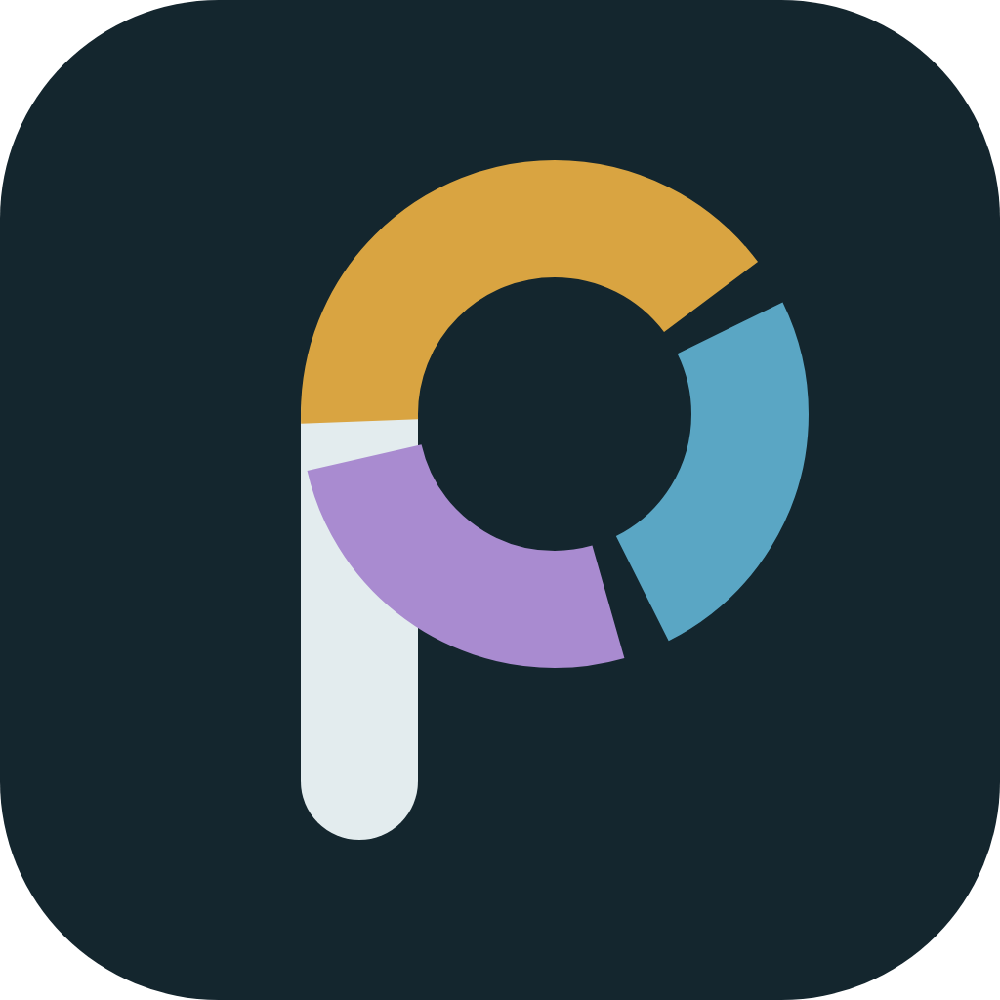
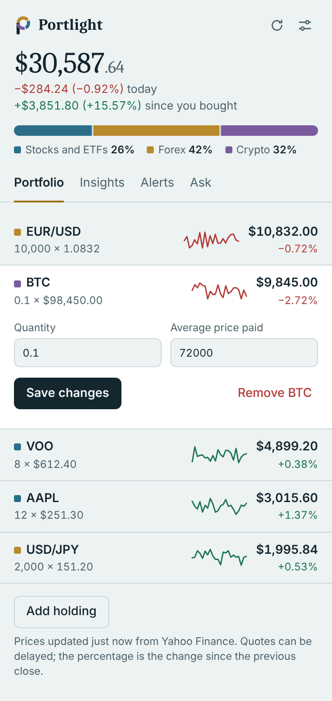
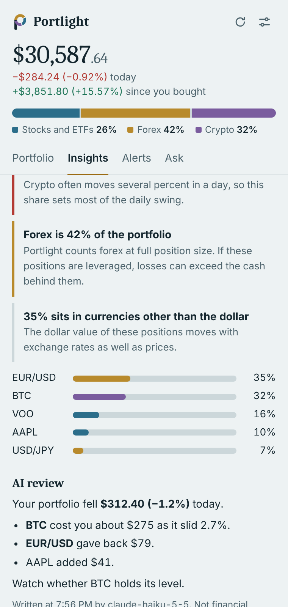

# Portlight: AI asset tracker (Chrome extension)

Tracks stocks, ETFs, forex pairs and crypto in Chrome's side panel, totals them in US dollars, and adds four AI features: a daily brief, a risk and allocation review, plain-language price alerts, and chat about your holdings.

 

Status: early version. It has been tested with simulated price and AI responses; expect rough edges with live data and please open an issue if a symbol fails to price.

## Install

1. Download this repository (Code > Download ZIP) and unzip it, or `git clone` it.
2. Open `chrome://extensions` in Chrome on a computer (Chrome on phones doesn't run extensions).
3. Turn on **Developer mode** (top right), choose **Load unpacked**, and select the repository folder (the one containing `manifest.json`).
4. Click the Portlight icon in the toolbar to open the side panel. Pin it from the puzzle-piece menu if it's hidden.

## Turn on the AI features

Open Settings (the sliders icon) and paste an Anthropic API key from https://console.anthropic.com. Use a key with a spending limit: it is stored unencrypted in Chrome on your computer. The default model is `claude-haiku-5-5`; you can switch to a larger one.

Without a key, tracking, the rule-based risk check and simply worded alerts ("AAPL above 250", "EUR/USD drops 1%") still work.

## How it works

- **Symbol dropdown**: the Add holding form suggests symbols as you type, from a built-in list of common stocks, ETFs, forex pairs and coins plus Yahoo Finance search. You can still type any symbol by hand.
- **Prices**: Yahoo Finance's public chart endpoint, with CoinGecko (crypto) and open.er-api.com (forex) as backups. These are free, keyless and unofficial; quotes can be delayed and the endpoints can change without notice.
- **Forex holdings** are entered as units of the first currency (10,000 EUR/USD = 10,000 euros) and valued at full position size. Leverage is not modelled.
- **Alerts** are checked every 5 minutes while Chrome is running and arrive as desktop notifications. Price alerts fire once until you choose "Watch again"; daily-change alerts reset each day.
- **Privacy**: holdings, alerts and settings stay in `chrome.storage.local`. Holdings are sent to Anthropic only when you use the brief, review, chat, or a free-form alert.

Portlight describes and flags; it is not financial advice.

## Development

No build step. Run the logic tests with `node test/logic.mjs`.

## License

MIT. See `LICENSE`.

## Files

- `manifest.json`, `background.js`: extension setup and the 5-minute price and alert check
- `sidepanel.html/.css/.js`: the interface
- `lib/prices.js`: price sources; `lib/portfolio.js`: totals and risk rules; `lib/alerts.js`: alert parsing; `lib/ai.js`: prompts and the Anthropic API call
